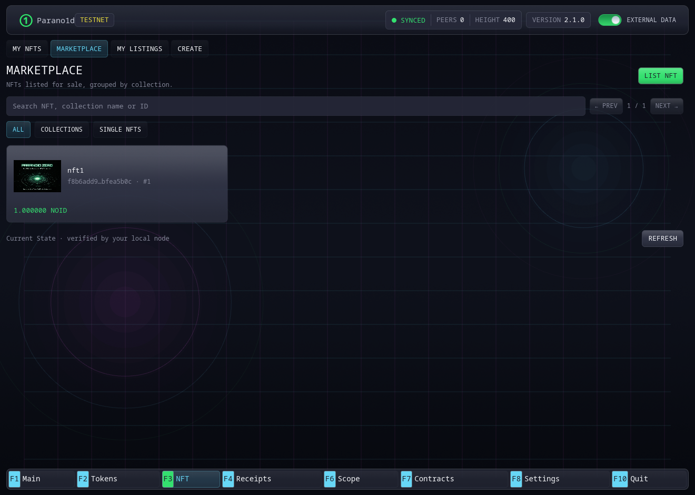

# NFT

В **F3 → NFT** находятся **My NFTs**, **Marketplace**, **My Listings** и
**Create**. Все операции с NFT выполняются в этом разделе.

## Мои NFT и маркетплейс

**My NFTs** показывает ваши NFT карточками коллекций и одиночных элементов.
Созданные вами коллекции остаются доступны для добавления новых NFT.
Фильтры **All**, **Collections**, **Single NFTs** и поиск помогают выбрать
нужные элементы по имени, ID или номеру.

**Marketplace** показывает действующие предложения продажи в таком же виде.
На карточке коллекции указаны количество выставленных NFT и минимальная цена.
Откройте коллекцию для выбора NFT или карточку одиночного NFT для покупки.
**My Listings** показывает выставленные элементы активного адреса.

## Создать одиночный NFT

В **Create → Single NFT** укажите название, изображение, описание и
необязательный сайт по HTTPS. Создание состоит из двух подтверждённых
транзакций, каждая со своей комиссией сети:

1. **Prepare, шаг 1/2:** проверьте и подтвердите подготовку. После подтверждения
   заготовка появится на подготовленной карточке в **My NFTs**.
2. **Mint, шаг 2/2:** проверьте и подтвердите выпуск. NFT появится в
   **My NFTs**. Его можно будет отправить или выставить на продажу.

Форма и статус отправки показывают текущий шаг. **Complete NFT** продолжает
подготовленный NFT, в том числе после перезапуска кошелька.

## Создать коллекцию и добавить NFT

1. В **Create → Collection** укажите название, необязательные обложку,
   описание и сайт по HTTPS. Проверьте и подтвердите создание.
2. Откройте подтверждённую коллекцию в **My NFTs** и нажмите **Add NFTs**.
3. Выберите сразу несколько изображений PNG, JPEG или WebP. Кошелёк предложит
   имя каждому NFT. При необходимости измените имена, общее описание и сайт.
4. Проверьте количество, диапазон номеров и комиссию, затем подтвердите выпуск.
   Вся пачка выпускается вместе в одной транзакции.

Коллекция поддерживает последовательный выпуск новых NFT её автором, сейчас или последующими пачками. У каждого NFT свои изображение,
метаданные, номер и право владения. После сжигания номер остаётся использованным.

Нода сообщает лимит одной транзакции. Текущий профиль допускает до 122 NFT
при одном входе финансирования NOID. Если средствам соответствуют многочисленные
мелкие выходы, пачку может потребоваться уменьшить. Перед доказательством
проверяются фактическое число страниц и комиссия. Исходное изображение занимает до 4 МБ. Подготовленные изображения
всей пачки занимают до 128 МБ памяти. Остальные NFT
можно добавить следующей пачкой в ту же коллекцию.

У коллекции собственное проверяемое описание. Каждый NFT отдельно связывает
свои имя, описание, сайт и содержимое изображения с коммитментом. Кошелёк
проверяет эти данные, а права автора, владельца и условия продажи получает
из проверенного State. Изображения обслуживает настроенное
[хранилище медиа](asset-media.md).

## Передать или сжечь

Откройте NFT в **My NFTs** и выберите **Send**. Проверьте адрес получателя
и комиссию. Операция передаст право владения именно этим NFT.

**Burn** необратимо уничтожает элемент. Его серийный номер остаётся использованным.

Отправка, сжигание, листинг, покупка и отмена открываются в форме поверх
текущей вкладки. Закрытие или **Esc** возвращают к прежнему выбору.

## Выставить и купить

Откройте **Marketplace → List NFT**, выберите свой доступный NFT и укажите цену
в NOID. Проверьте комиссию и подтвердите. Также можно открыть NFT в **My NFTs**
и нажать **List for sale**. После подтверждения продажа появится в
**My Listings** и **Marketplace**.

В **My Listings** каждый NFT показан отдельно с ценой, сроком и кнопкой
**Remove listing**. Поиск и фильтры сохраняются отдельно от **My NFTs**.

Продажа действует 2 880 блоков с высоты создания, примерно сутки при целевом
интервале. В листинге находятся NFT и 0.1 NOID для комиссии возврата.
Комиссия создания показывается отдельно.

Покупатель открывает листинг в **Marketplace**, проверяет точный NFT и цену,
затем подтверждает покупку. Оплата и переход владения выполняются атомарно.
Продавец получает цену и депозит листинга. Если другой покупатель успел первым,
нода отклонит расход уже использованного экземпляра листинга.

Через **My Listings → Remove listing** можно вернуть непроданный NFT и остаток
депозита после комиссии отмены. После подтверждения его можно снова выставить
по другой цене. После подтверждённой продажи NFT принадлежит
покупателю.

История операций и сохранённые чеки переживают перезапуск. Экспортируйте
важные NFT-чеки из **Receipts**. Текущего владельца можно восстановить из State.
Чек сохраняет доказательство исторической операции после удаления её тела.
Также сохраняйте резервную копию кошелька и описания медиа.

Скриншот сделан в настоящем Rust/Iced кошельке в изолированной тестовой сети.
Подробные правила находятся в [спецификации](../../../protocol/native-finance.md).
