# Tokens, trading and NFTs in the wallet

The wallet creates tokens, trades on bonding curves and the native DEX, and
manages NFTs and marketplace listings. Your node verifies ownership, backing,
payments and the resulting State through the recursive block proof.

The screenshots below show the actual Rust/Iced wallet on an isolated test
network. **TESTNET** identifies that network. Names, balances and addresses
are examples. Use the address and asset identity shown in your own wallet.

## Start with the active address

Open **F1 Main**. Check the connection is **Synced**, select the address that
will pay the fee and keep some spendable NOID on that address. **Send** opens
the payment dialog. The balance selector starts with NOID and includes tokens
held by the active address.

**F2 Tokens** contains token holdings, Launchpad, DEX and creation.
**F3 NFT** contains your NFTs, Marketplace, My Listings and creation.
**F4 Receipts** retains the confirmed operations.

## Create a token with an optional first purchase

1. Open **Tokens → Create**, or choose **Create Token** in Launchpad.
2. Enter the name, ticker and fixed whole-token supply. The minimum is
   **100,000 tokens**. All tokens have six decimal places.
3. Optionally add a description, HTTPS project website and logo.
   **Choose Logo** accepts PNG, JPEG or WebP up to 4 MB.
4. For a first purchase, enter the number of tokens in **Initial buy**.
   Leave it at zero to open the curve at its starting price.
5. Read **NOID backing deposit** and **Initial buy cost** before choosing
   **Review**.

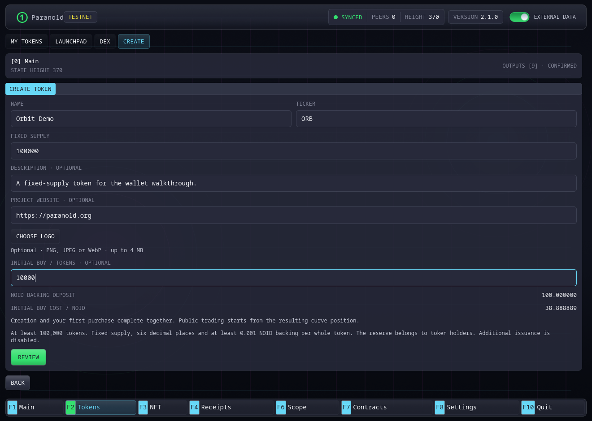

Holder backing is **0.001 NOID per whole token**. A supply of 100,000 tokens
requires 100 NOID of backing. Buying 10,000 tokens during that creation costs
another 38.888889 NOID. The network fee is shown separately.

The first purchase can buy up to 60% of supply, which is the entire curve
allocation. The remaining 40% is reserved for permanent DEX liquidity.
Creation and the first purchase complete in one transaction. The creator
receives the purchased tokens, and other trading starts at the resulting
curve price. The supply is fixed for the token's lifetime.

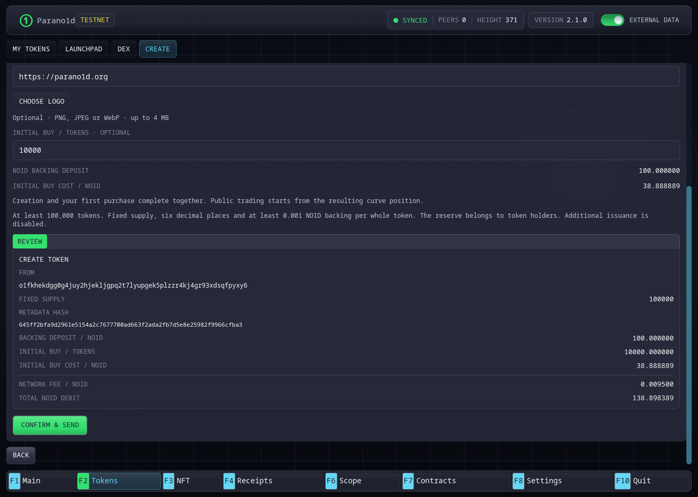

Check the active address, supply, purchased quantity, backing, purchase cost,
network fee and total NOID debit. Choose **Confirm & Send** once. Wait for
confirmation, then find the token under **My Tokens** and **Launchpad**.

## Find a token and check its identity

**My Tokens** shows tokens held or created by the active address. Search by
name, ticker or full asset ID. Select a row to see the exact asset ID, balance,
locked quantity and available actions. Use the copy icon for the complete ID.

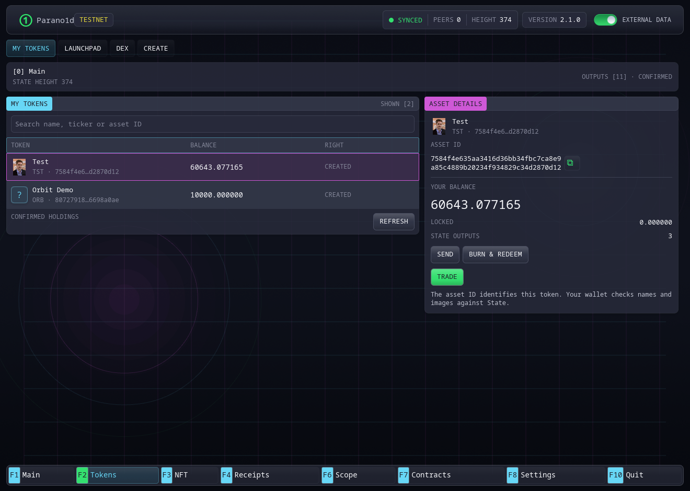

**Launchpad** has **New**, **Top Gainers** and **Graduated** filters. Cards show
the logo, name, ticker, price and curve progress. Price change is relative to
the standard curve starting price. **Graduated** keeps tokens that have moved
to DEX. Opening one takes you to its DEX market.

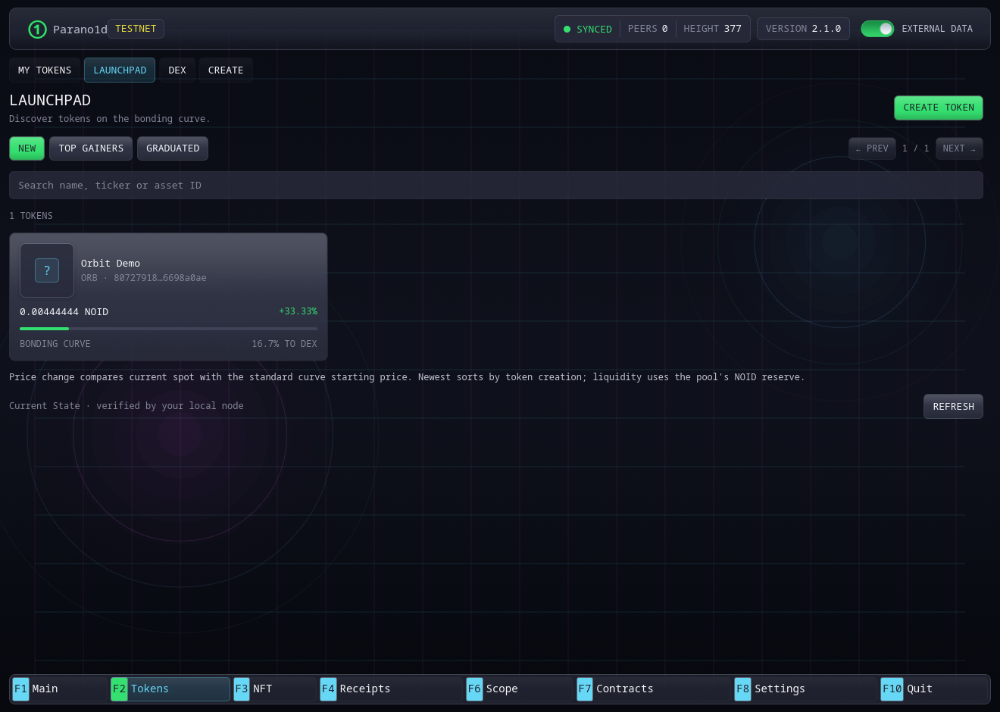

## Buy or sell on a bonding curve

1. Open a token in Launchpad. Its page shows the curve, current position,
   committed token information and trade form.
2. Choose **Buy** or **Sell**.
3. For a buy, enter NOID to spend. For a sale, enter the token quantity.
   **MAX** uses the available unlocked, unreserved token balance.
4. The default price tolerance is **10%**. Enter your own minimum receive
   quantity to set an exact lower bound.
5. Choose **Review** and inspect the expected output, minimum output,
   network fee ceiling and last valid block.

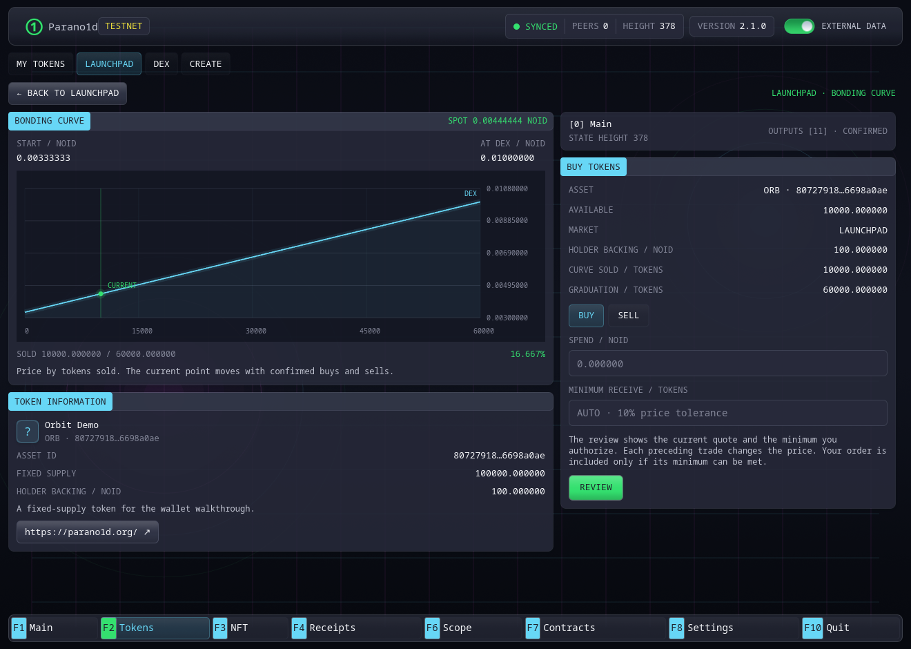

The quote includes pending trades currently known to your node. Different
nodes can know different pending orders. Your approved minimum output and fee
ceiling stay fixed. Several trades can execute in one block, each using the
reserves left by the preceding trade.

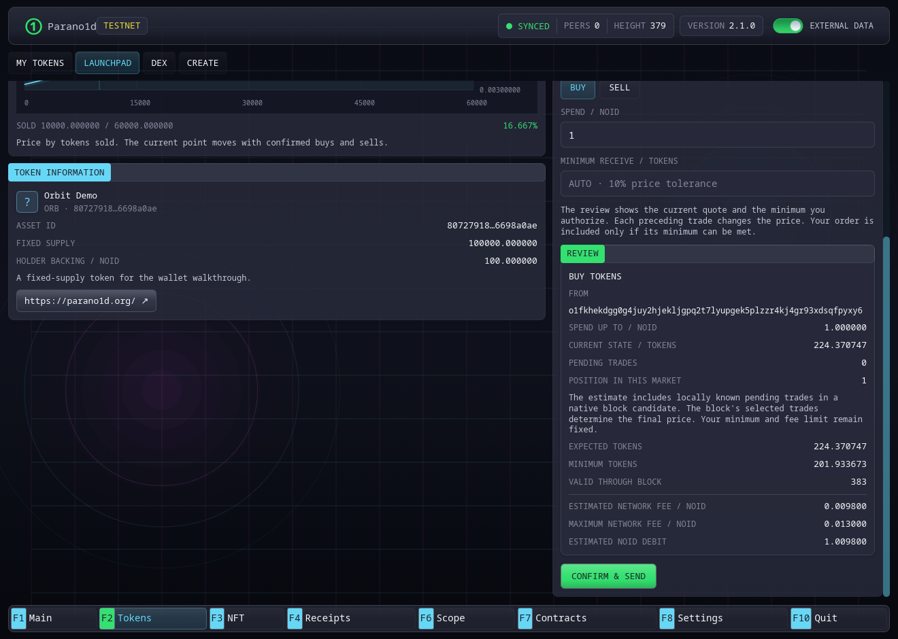

After **Confirm & Send**, the status becomes **Waiting for confirmation**.
It closes after confirmation and a balance refresh. **Close** returns to the
trade form while Receipts keeps the operation's status.

A policy that cannot meet its minimum leaves its sources unspent. The default
validity window covers four candidate heights, about two minutes at the
30-second interval. Pending sources remain reserved in the local wallet until
confirmation or expiry is observed. An expired unfilled policy releases that
reservation on refresh and pays no execution network fee.

## Graduation and DEX trading

Graduation happens automatically when the curve allocation sells. The same
asset and holder balances continue on DEX. The curve cash and remaining token
allocation become permanent liquidity.

| Supply | Holder backing | Curve allocation | DEX allocation | Curve cash at graduation |
| ---: | ---: | ---: | ---: | ---: |
| 100,000 tokens | 100 NOID | 60,000 tokens | 40,000 tokens | 400 NOID |
| 5,000,000 tokens | 5,000 NOID | 3,000,000 tokens | 2,000,000 tokens | 20,000 NOID |

Holder backing stays in its separate redemption reserve. The creator's first
purchase counts toward curve progress.

**DEX** shows graduated tokens with **Liquidity**, **Top Gainers** and
**Newest** sorting. Search and pagination keep the catalogue manageable.

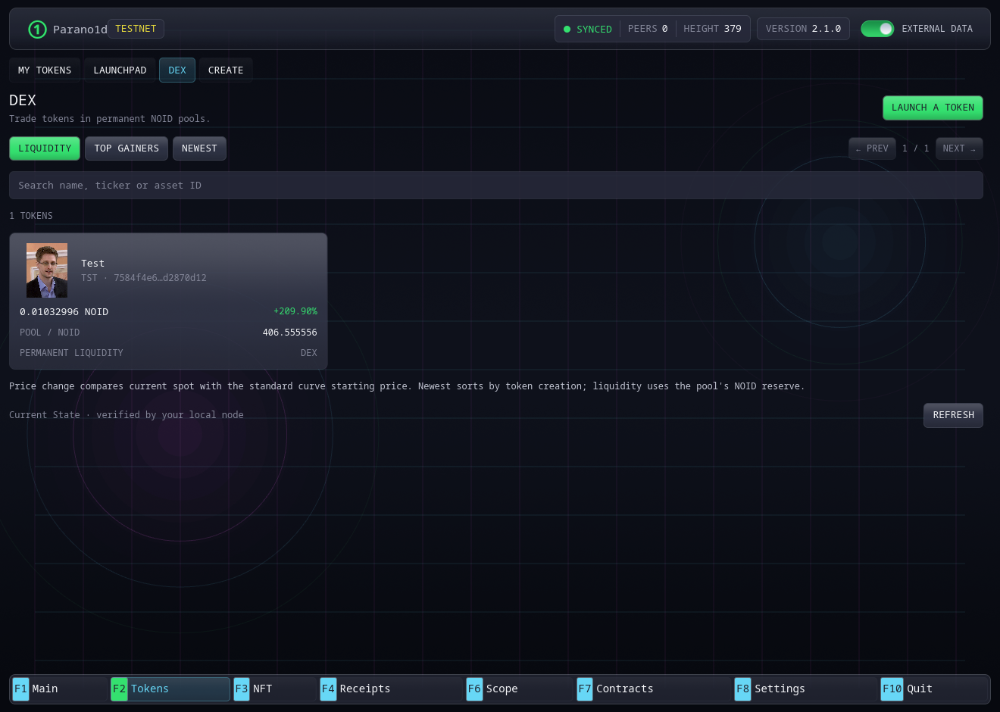

Open a card and use the same Buy, Sell and Review flow. Check pool reserves,
current price and the complete asset ID. The DEX fee is 0.3% of input, rounded
up to a base unit. The network fee appears separately.

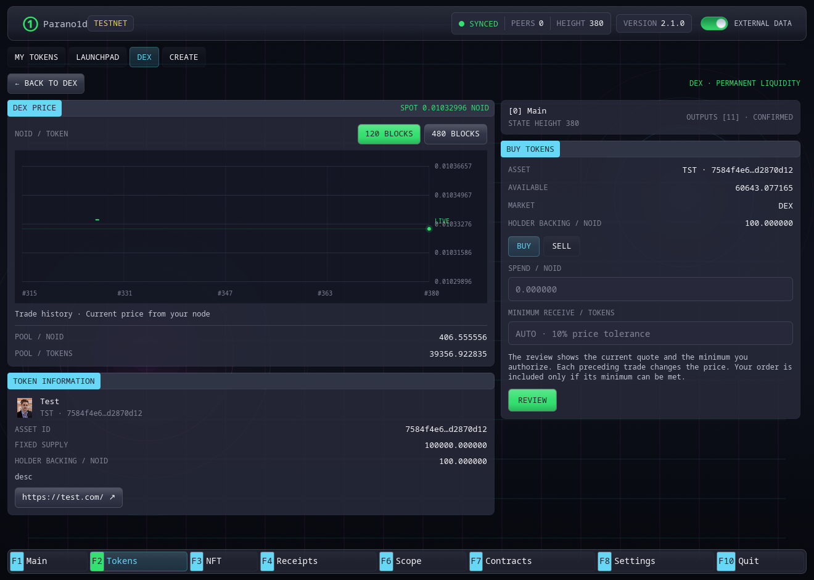

The live price comes from your node. With **External data** enabled, the open
market also loads price history. **Back** returns to the originating catalogue
with its search, filter, page and scroll position.

## Send tokens

Open **My Tokens**, select the asset and choose **Send**. You can also select
the token in the Main send dialog.

Paste the recipient's `o1` address and enter the quantity. **MAX** fills the
available balance. Review the exact asset, recipient, quantity and NOID network
fee before confirmation. Keep NOID for that fee on the sending address.

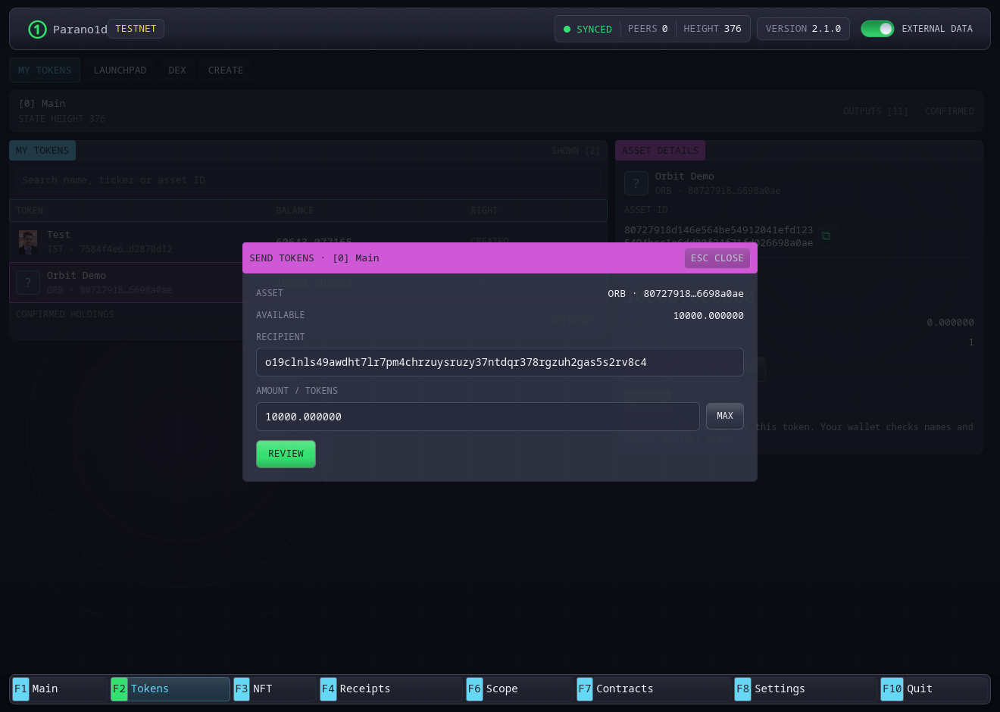

The dialog opens over the current workspace. **Esc** or Close returns to the
same selection.

## Burn tokens and redeem backing

Choose **Burn & Redeem** for the selected token. Enter a quantity or choose
**MAX**, then review the NOID returned and network fee. Confirmation destroys
the tokens and pays their proportional backing in one transaction.

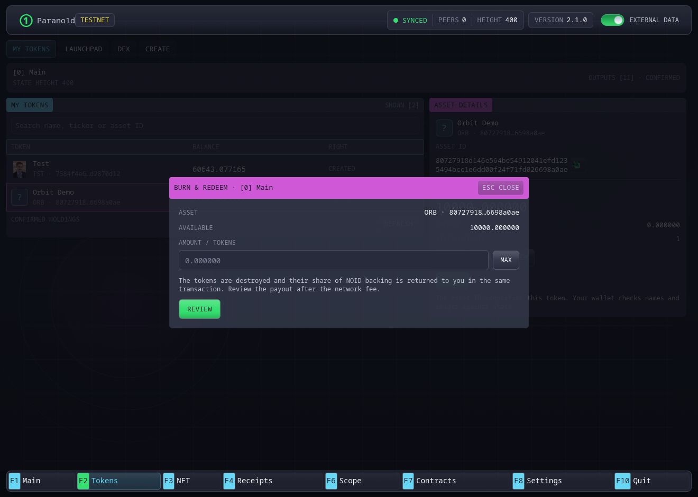

The reserve pays the integer part of `reserve × burned / outstanding`.
Rounding stays with remaining holders. Burning the final outstanding units
returns the whole remaining reserve.

## Create one NFT

1. Open **NFT → Create → Single NFT**.
2. Enter its name and choose an image. Description and HTTPS project website
   are optional. Images accept PNG, JPEG or WebP up to 4 MB.
3. Choose **Review preparation · Step 1/2**, check the fee and confirm.
4. After confirmation, open the prepared card in **My NFTs** and choose
   **Complete NFT**.
5. Review and confirm **Mint · Step 2/2**. The confirmed item is ready to send
   or list for sale.

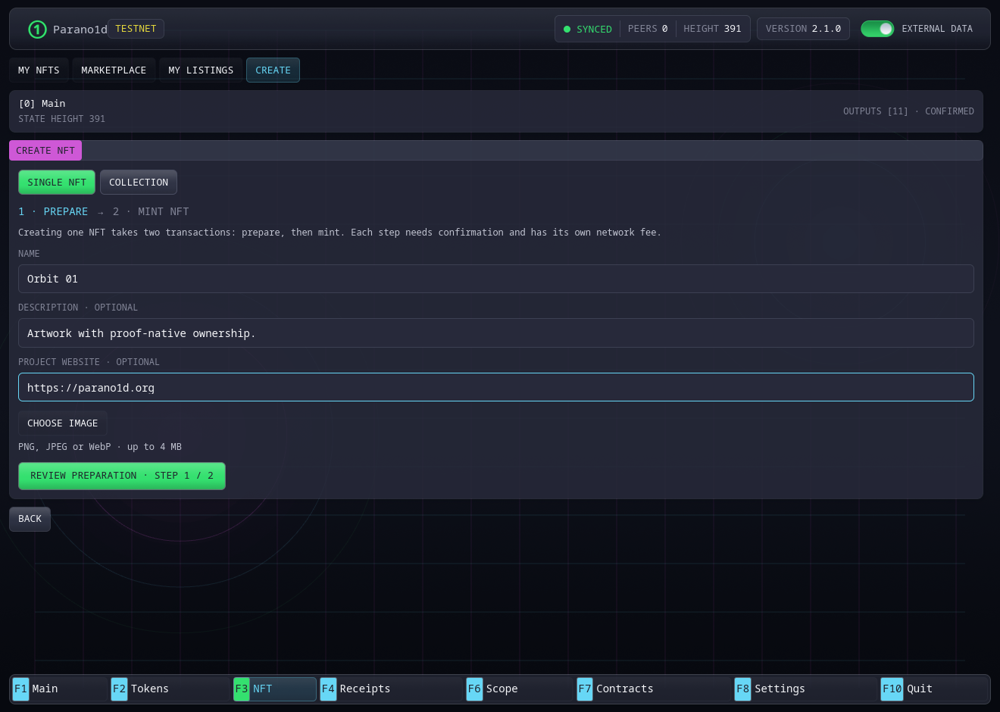

Each step is a transaction with its own fee. A prepared card survives a wallet
restart, so you can finish minting later.

## Create a collection and mint a batch

1. Choose **NFT → Create → Collection**. Enter its name and optionally its
   cover image, description and HTTPS website. Review and confirm.
2. Open the confirmed collection in **My NFTs**.
3. Choose **Add NFTs**, then **Add Images**. Select several image files.
4. Edit the suggested names and, if needed, the shared description and website.
5. Review the count, serial range and fee. Confirm once to mint the complete
   batch atomically.

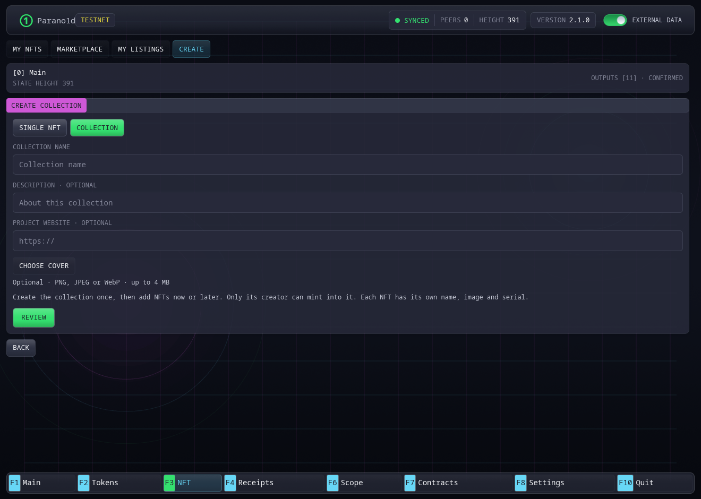

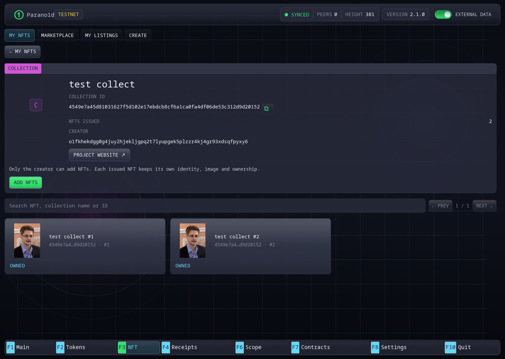

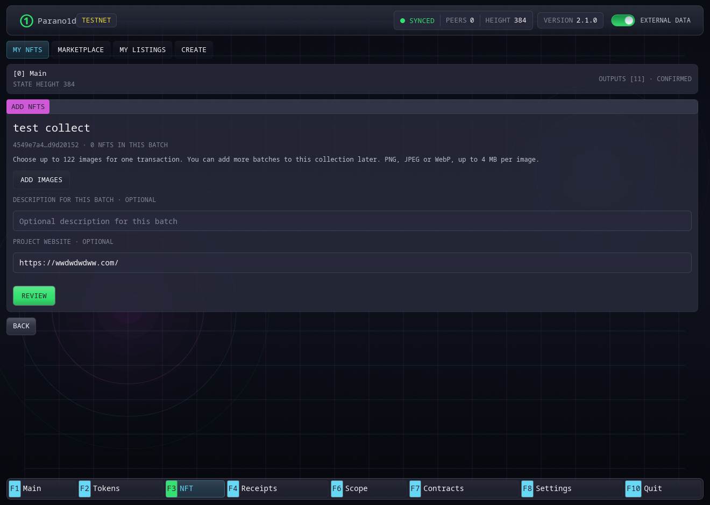

The current per-transaction ceiling is 122 items with one NOID funding input.
More funding inputs can reduce the available batch size. Review checks the
actual limits before proving. Each source image is limited to 4 MB, and the
prepared batch has a 128 MB memory limit.

Return to the same collection to mint another batch now or later. Only its
creator can add items. Each item has its own serial and metadata commitment.
Sending or burning an item preserves the serial's issuance record.

## Browse and transfer NFTs

**My NFTs** groups owned items and collections. Creator-owned collection cards
also provide the route for adding more items. Use **All**, **Collections** or
**Single NFTs**, plus search by name, ID or serial.

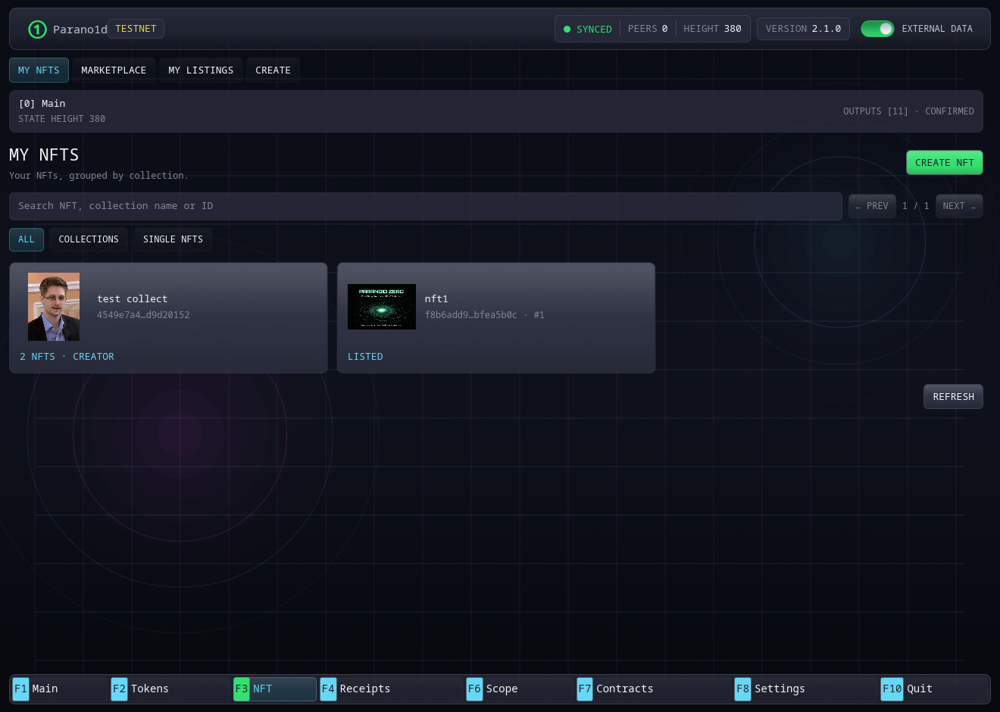

Open an owned item and choose **Send**. Paste the recipient, review the exact
collection and serial, and confirm the network fee. **Burn** permanently
consumes the selected item. These actions open dialogs over the NFT workspace.

## List an NFT, buy it or remove a listing

To sell, open **Marketplace → List NFT**, choose an available owned item and
enter its NOID price. Alternatively, open the item in My NFTs and choose
**List for sale**. Review the ask, 0.1 NOID listing credit, network fee and
expiry before confirming.

The confirmed listing appears in **Marketplace** and **My Listings**. A listing
lasts 2,880 blocks from creation, about a day at the 30-second interval.

A buyer opens the listing from a different address, checks its image,
collection, serial, seller and ask, then reviews the purchase. Confirmation
transfers the NFT and payment atomically. The seller receives the ask plus
the listing credit.

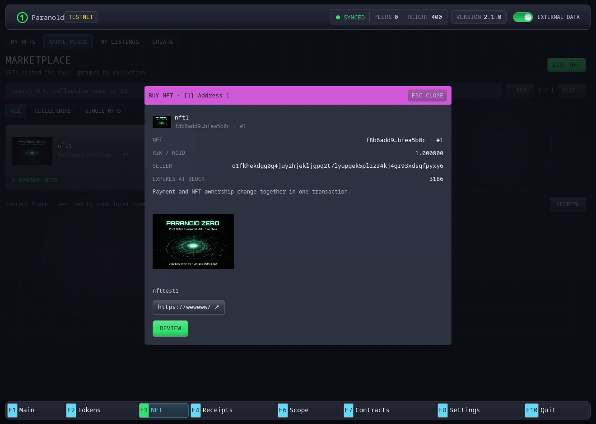

The seller opens **My Listings → Remove listing** to recover an unsold NFT
and remaining listing credit after the cancellation fee. After confirmation,
list it again to offer a different price.

## Images, charts and receipts

The header switch **External data** starts Off. Its tooltip reads **Load token
images and price history**. Turn it on for artwork, logos and the open DEX
market's history. Current balances, rights and live prices come from your node
in both modes.

**Settings → Interface → Clear asset cache** clears cached images, metadata
and chart data. The image cache is limited to 64 MiB. Prepared uploads and
saved receipts stay available.

After confirmation, open **F4 Receipts**. Choose All, NOID, Tokens, Trades or
NFT, then use Filters and sorting. Open an entry to check its canonical status
and copy its portable receipt. Export important receipts and keep a wallet
backup. Receipts remain verifiable after block-body pruning.

See [token rules](tokens.md), [NFT rules](nfts.md), [asset media](asset-media.md)
and the [native finance specification](../protocol/native-finance.md) for the
exact rules behind these operations.
