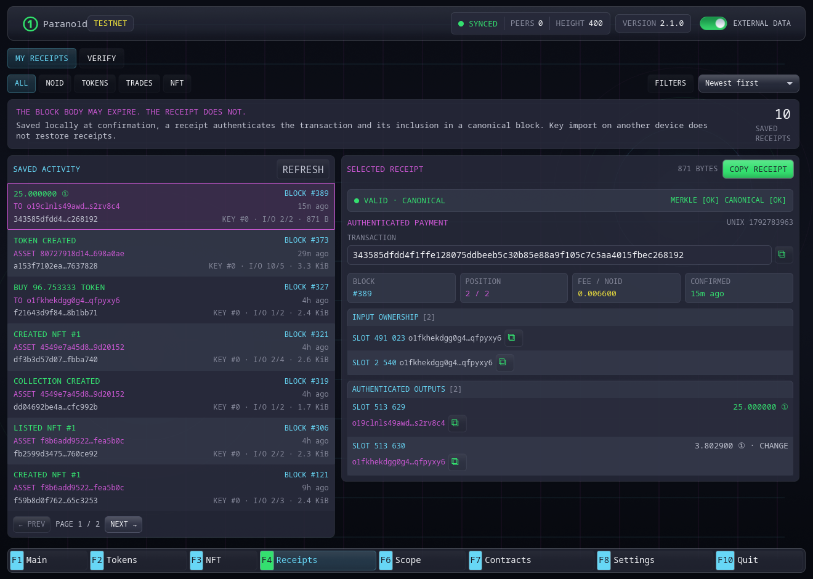

# Receipts

The Receipts section preserves and verifies payment, token, trade and NFT receipts.
Open it with `F4`.

## My receipts

**My receipts** lists saved payments to a distinct recipient and native asset
operations. Choose **All**, **NOID**, **Tokens**, **Trades** or **NFT**. Newest
entries appear first and the list is paginated. An exchange appears as one
operation with its individual asset inputs and payouts.

Open **Filters** to narrow the history by:

- the complete 64-character asset or NFT collection ID;
- operation, such as a transfer, trade, burn/redemption or NFT purchase;
- dates in `YYYY-MM-DD` format, in UTC; **Through** includes that whole day;
- verification status: **Confirmed**, **Off chain** or **Header unavailable**.

**Confirmed** means the receipt matches a retained canonical header. **Off
chain** means its inclusion data is internally valid but differs from the
current header. **Header unavailable** means the node has no canonical header
at the claimed height. Opening a receipt shows its detailed verification.

Select **Apply** after editing filters. **Clear** removes the additional
filters while keeping the selected family. The sort menu offers newest,
oldest, asset and operation order. Filters and sorting cover the complete
saved history before pagination. Asset sorting uses full identities; matching
names or tickers do not combine assets.

Pending and unconfirmed submissions appear separately from saved receipts.
Confirmed operations appear in the receipt library. Selecting a
verification-status filter shows only the receipt library. If the chain or
saved library changes during a query, refresh to read a consistent result.

Selecting an entry shows its authenticated summary:

- logical transaction ID;
- canonical block height and transaction position;
- input owner and input records;
- recipient and change outputs;
- amount and fee;
- inclusion and canonical verification status.

The receipt is saved only after confirmation while complete block data is
available.

## Local-only records

Receipts are stored in `wallet.receipts` on this device. Importing the master
secret on another computer restores addresses and live funds, but not receipt
history.

Back up the file or export individual receipt text if payment evidence matters.
Loss of receipts does not affect spendable balance.

The store appends checksummed changes and periodically compacts them with an
atomic snapshot instead of rewriting the entire collection on every change.
Exported receipt text is independent of this local storage format.
See [wallet artifact storage](../reference/files-and-ports.md#wallet-artifact-storage)
for format and integrity checks.

## Verify

The **Verify** tab accepts exported hexadecimal receipt text. Verification
checks the transaction data and fixed-depth inclusion path, then compares the
claimed transaction root with the permanent canonical header when a node is
available.

The result distinguishes:

- a structurally valid inclusion proof;
- a receipt bound to the current canonical chain;
- invalid or malformed data.

## Consolidation and derived addresses

Same-owner consolidation does not create a receipt because it is not evidence
of payment to another owner.

A send to an inactive address derived by the same master secret does create a
receipt. Consensus sees a distinct recipient owner and does not scan the
wallet's possible address set.

For the underlying proof format, see
[Receipts and pruned history](../concepts/receipts.md).

## Contract calls

F4 handles ordinary payments, including deposits to a contract, and native
token, trade and NFT receipts.
Call receipts and shared contract files open in **F7 Contracts → Open file**.
They include public terms and proof of a state transition. Import merges
verified evidence into the local contract journal while preserving existing
records. See [contract receipts and recovery](../contracts/receipts-and-recovery.md).
